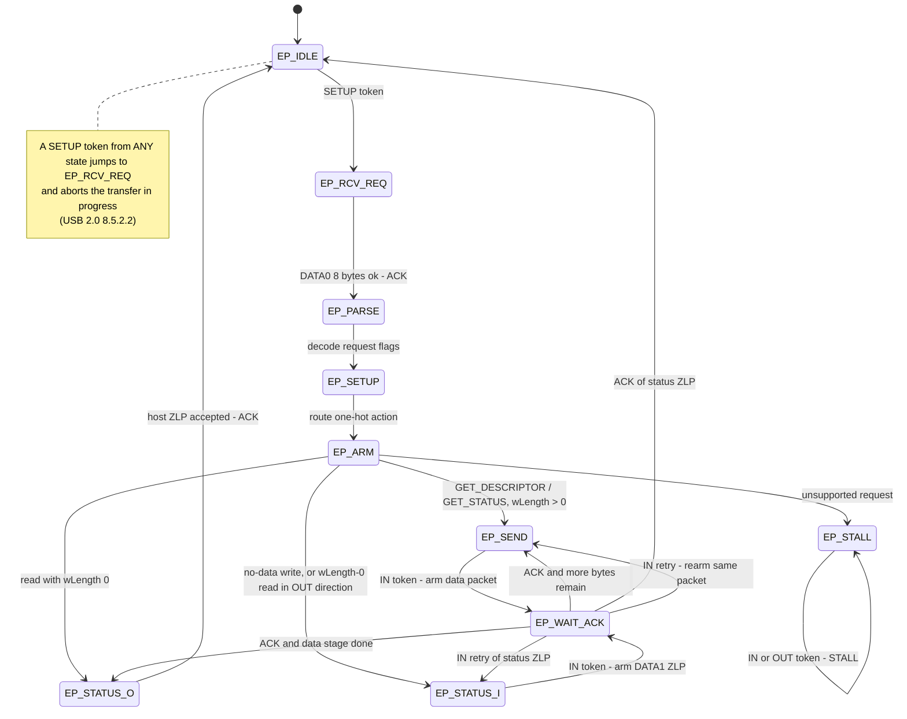

# `endpoint::Ep0` — control transfers and enumeration

`endpoint::Ep0` (`src/endpoint.vir`) is the control-transfer state machine for
**EP0**, the endpoint every USB device must implement. It is the module the
host talks to first: it answers **GET_DESCRIPTOR** (device, configuration,
strings) and **GET_STATUS**, applies **SET_ADDRESS** and
**SET_CONFIGURATION**, and serves the CDC-specific request
**SET_CONTROL_LINE_STATE**. It never touches the pads — it sees the world
as router-gated packet strobes from [`usb::UsbUart`](usb-uart.md) and
answers with small `resp_*` "please send this" records that the tx PHY
([usb-tx-phy.md](usb-tx-phy.md)) turns into wire packets.

Prerequisites: [usb-primer.md](usb-primer.md) (tokens, PIDs, packets),
[usb-rx-packet.md](usb-rx-packet.md) (where `dt_valid`/`dt_head` come from),
[system-overview.md](system-overview.md) (how the modules stack up).

## What a control transfer is

Recall from [usb-primer.md](usb-primer.md): a USB *transaction* is a token
packet, optionally a data packet, optionally a handshake. A control
*transfer* is a fixed three-act play built from such transactions
(USB 2.0 §8.5.3):

1. **SETUP stage** — the host sends a SETUP token followed by a **DATA0**
   data packet carrying exactly **8 request bytes**. The device must accept
   it and ACK.
2. **DATA stage** (optional) — either:
   - a *control read*: the host polls with IN tokens and the device sends
     `wLength` (or fewer) bytes, or
   - a *control write*: the host sends data with OUT tokens.
   No data stage at all is also legal (e.g. SET_ADDRESS).
3. **STATUS stage** — a zero-length transaction in the *opposite* direction
   of the data stage. For a control write (or no-data request) the *device*
   sends a zero-length **DATA1** packet ("status ZLP") in reply to an IN
   token; for a control read the *host* sends a zero-length DATA1 after an
   OUT token and the device ACKs it.

The 8 request bytes are a little fixed-layout structure. `endpoint::Ep0` latches
them into `rq0..rq3, rq6, rq7` (`wIndex`, bytes 4–5, is never needed and
simply not kept):

| Byte | Register | Field | Meaning |
|------|----------|-------|---------|
| 0 | `rq0` | `bmRequestType` | direction (bit 7), type (standard/class), recipient |
| 1 | `rq1` | `bRequest` | which request (e.g. `0x06` = GET_DESCRIPTOR) |
| 2–3 | `rq2`/`rq3` | `wValue` low/high | request-specific (descriptor type/index, address…) |
| 6–7 | `rq6`/`rq7` | `wLength` | bytes the data stage will carry |

The toggles follow strict rules (see the `endpoint::Ep0` banner in
`src/endpoint.vir`): SETUP is always DATA0 and **resets the toggle**; the *data*
stage starts at DATA1 for both directions; the status packet is always a
zero-length DATA1. See [Data toggles on EP0](#data-toggles-on-ep0) below.

## What enumeration is

Enumeration is the host's boot-time interrogation of a freshly attached
device, conducted entirely over EP0. A typical pass against this core:

1. **Bus reset** — the host holds SE0 for ≥ 2.5 µs; `usb::RxPhy` pulses
   `bus_reset`, which drops `dev_addr` to 0, `configured` to 0 and the
   state machine to `Idle`.
2. **GET_DESCRIPTOR(device)** — the host learns vendor/product IDs and
   `bMaxPacketSize0 = 64` (ROM byte `desc_rom[7]`). It asks for 64 bytes;
   the device sends `min(64, 18) = 18` — a *short packet*, which is how the
   data stage ends early.
3. **SET_ADDRESS(n)** — the host picks an address; the device applies it
   only when the transfer completes (see [the address latch](#the-address-latch)).
4. **GET_DESCRIPTOR(config)** at the new address — 75 bytes, delivered as a
   64-byte DATA1 packet plus an 11-byte DATA0 packet (two IN transactions).
   The host reads the string descriptors the same way.
5. **SET_CONFIGURATION(1)** — `configured` goes 1; the token router starts
   forwarding EP1 traffic to `endpoint::Serial`, and a `cfg_strobe` pulse
   resets the bulk data toggles (USB 2.0 §9.1.1.5) — see
   [usb-serial.md](usb-serial.md).
6. **CDC requests** — `SET_CONTROL_LINE_STATE` (the host asserts DTR when a
   program opens `/dev/ttyACM0`). The device accepts it (ACK only) but the
   echo server in `src/top.vir` ignores the DTR/RTS bits. The line-coding
   requests (`SET_LINE_CODING`/`GET_LINE_CODING`) are *not* implemented:
   they decode to STALL like any other unsupported request.

After step 5 the host has a working CDC-ACM port; all bulk data moves on
EP1 ([usb-serial.md](usb-serial.md)). EP0's job is done until the host
re-enumerates.

## Ports

| Port | Dir | Width | Purpose |
|------|-----|-------|---------|
| `clk`, `rst`, `bus_reset` | in | 1 | 48 MHz clock, sync reset, bus-reset pulse |
| `tk_setup` / `tk_in` / `tk_out` | in | 1 | router-gated EP0 token strobes (address + endpoint matched, registered by the router); `tk_out` is decoded but unused by the FSM |
| `dt_valid` | in | 1 | router-gated data packet for EP0 (registered +1 clk) |
| `dt_pid`, `dt_len` | in | 4, 7 | data packet PID and byte length |
| `dt_head` | in | 64 | flopped copy of payload bytes 0–7 ([usb-rx-packet.md](usb-rx-packet.md)) |
| `dt_crc_ok` | in | 1 | CRC16 residual check passed ([usb-crc.md](usb-crc.md)) |
| `hs_ack` | in | 1 | EP0's in-flight response was ACKed by the host |
| `resp_req` | out | 1 | 1-clk pulse: start transmitting a response |
| `resp_pid`, `resp_len` | out | 4, 7 | response PID / payload length (0 = handshake or ZLP) |
| `resp_sel`, `resp_base` | out | 3, 10 | descriptor select + byte offset for the ROM read |
| `dev_addr` | out | 7 | device address (latched at status completion) |
| `configured` | out | 1 | SET_CONFIGURATION(1) has completed |
| `ep0_busy` | out | 1 | EP0 expects a data packet (SETUP request or status-stage ZLP) |
| `ep0_stalling` | out | 1 | EP0 is STALLing (router hint, see below) |
| `ep0_wait_ack` | out | 1 | EP0 has a response in flight (handshake-router hint) |

Note what is *absent*: no FIFOs, no pads, no descriptor storage. The module
is pure protocol. The three hint outputs are how the router in
[usb-uart.md](usb-uart.md) decides who owns each incoming data packet
(`ep0_dt_gate = rxpkt.dt_valid && (ep0_busy || (ep0_stalling &&
last_out_ep0))`) and each incoming ACK (`ep0_hs_ack = rxpkt.hs_valid &&
(hs_pid == ACK) && ep0_wait_ack`).

## The state machine

`endpoint::Ep0` is a classic registered FSM (`st`, the 10-state `Ep0State` enum
in `src/endpoint.vir`) plus a small pipeline of helper registers — factored
into three mods: the FSM + response/status/hint registers in `endpoint::Ep0`,
the request-decode pipeline in `endpoint::Ep0ReqDecode`, the data-stage send
datapath in `endpoint::Ep0SendEngine` (all in `src/endpoint.vir`). The state
encodings are deliberately non-sequential: `Parse = 8`, `Setup = 9`,
`Arm = 10` are the three decode stages that follow `RcvReq = 1`, written in
the order the request flows through them (`StatusI = 5`, `StatusO = 6` and
`Stall = 7` sit between the data stages and the decode states so the
"transfer" states stay grouped).

There is no receive-data state: every request with a data stage is a
*control read* (the device transmits descriptor or status bytes), so the
only OUT data packet EP0 ever consumes outside SETUP is the status-stage
ZLP of a control read.

### Why four states just to read a request

Decoding "which request is this?" means comparing byte values at three
levels (request type → descriptor type → string index). That compare tree
is too deep for one 48 MHz clock, so it is *pipelined one compare per
clock* (see the `endpoint::Ep0ReqDecode` banner in `src/endpoint.vir`):

- **`EP_RCV_REQ`** — wait for the SETUP DATA0 (8 bytes, CRC good:
  `req_acc_r`), ACK it, latch the request bytes into `rq*`.
- **`EP_PARSE`** — turn `rq*` into one-hot *flags*: `p_is_desc`,
  `p_is_get_status`, `p_is_set_addr`, `p_is_set_cfg`, `p_is_cls`, plus
  `p_valid`, `p_sel` (the descriptor select) and `p_wlen`, and the
  side-effect values `addr_pending`/`cfg_pending` with their ownership
  tags `pend_addr`/`pend_cfg`.
- **`EP_SETUP`** — route the flags into a single one-hot **action**
  register `p_action` (0 = STALL, 1 = no-data write → status IN,
  2 = GET_STATUS, 3 = GET_DESCRIPTOR) and precompute the data-stage length
  `p_dremain_r = min(wLength, dlen(p_sel))` for descriptor reads, plus
  `p_wlen0` and the descriptor direction `p_desc_in` (= `rq0[7]`).
- **`EP_ARM`** — apply the action to the datapath (`sel`, `remain`, `tog`,
  next state) with shallow decodes only.

The same idea recurs everywhere: wide decisions land on their *own*
register one clock early, and the FSM reads the register. The two data-stage
accepts (`req_acc_r`, `sto_acc_r`) are registered copies of accept
conditions; the FSM reacts one clock late. That is bit-identical and free:
USB gives a device ~30–50 clocks to answer a token, and every field
involved (`dt_pid`, `dt_len`, `dt_head`, `dt_crc_ok`) is itself a register
that holds until the next packet. STALL responses need no such pipeline:
once in `EP_STALL`, the FSM fires `resp_req` directly on the next IN token
or OUT data packet.

### Three worked examples

**Control read — GET_DESCRIPTOR(device)** (`80 06 00 01 00 00 40 00`):
EP_RCV_REQ latches and ACKs → EP_PARSE sets `p_is_desc`, `p_sel = 0`,
`p_wlen = 64` → EP_SETUP computes `p_action = 3` (GET_DESCRIPTOR) and
`p_dremain_r = min(64, 18) = 18` → EP_ARM arms: `sel = 0`, `tog = 1`,
`remain = 18`, state EP_SEND. The host's IN token makes EP_SEND arm an
18-byte DATA1 response (`resp_sel = 0`, `resp_base = 0`); `usb::UsbUart`
computes the ROM address and the tx PHY streams the bytes out (see
[descriptor ROM reads](#descriptor-rom-reads)). The host ACKs → `last_r`
was set (18 < 65) → EP_STATUS_O. The host sends OUT + a zero-length DATA1,
the device ACKs (`sto_acc_r`) and returns to EP_IDLE.

**Control write, no data — SET_ADDRESS(9)** (`00 05 09 00 00 00 00 00`):
EP_PARSE sets `p_is_set_addr`, `addr_pending = 9`, `pend_addr = 1` →
EP_SETUP routes to action 1 → EP_ARM goes straight to EP_STATUS_I (no data
stage). The host's IN token gets the zero-length DATA1 status packet; when
the host ACKs it, EP_WAIT_ACK applies `dev_addr <= 9` and returns to
EP_IDLE.

**Control read, 2 bytes — GET_STATUS(device)** (`80 00 00 00 00 00 02 00`):
EP_PARSE sets `p_is_get_status` → EP_SETUP routes to action 2 → EP_ARM
arms: `sel = 6`, `remain = min(wLength, 2) = 2`, `tog = 1`, state EP_SEND.
The host's IN token makes EP_SEND arm a 2-byte DATA1 packet; the producer
mux in `usb::UsbUart` returns two `0x00` bytes for sel 6 (no ROM read).
The host ACKs → `last_r` → EP_STATUS_O; the host's OUT + zero-length DATA1
is accepted (`sto_acc_r` — deliberately lenient on the data PID) and the
device ACKs, back to EP_IDLE.

## Supported requests

Everything is decoded in EP_PARSE from `rq0`/`rq1` (and `rq2`/`rq3` where
noted), routed in EP_SETUP into `p_action`:

| Request | Match | Data stage | Result |
|---------|-------|------------|--------|
| GET_DESCRIPTOR(device) | `rq1=06`, `rq3=01` | IN, `min(wLength,18)` B | ROM page 0 |
| GET_DESCRIPTOR(config) | `rq1=06`, `rq3=02` | IN, `min(wLength,75)` B | ROM page 1 (2 packets) |
| GET_DESCRIPTOR(string 0/1/2) | `rq1=06`, `rq3=03`, `rq2=0/1/2` | IN, `min(wLength, 4/10/32)` B | ROM pages 2–4 |
| GET_STATUS(device) | `rq1=00`, `rq0=80` | IN, `min(wLength,2)` B | two `0x00` bytes (`sel 6`) |
| SET_ADDRESS | `rq1=05` | none | `dev_addr <= rq2[6:0]` at status |
| SET_CONFIGURATION(0/1) | `rq1=09`, `rq2=00/01` | none | `configured` at status |
| SET_CONTROL_LINE_STATE | `rq1=22`, `rq0=21` | none | ACK only; DTR/RTS bits ignored |

Anything else — an unknown `bRequest`, a string index > 2,
GET_CONFIGURATION, GET_LINE_CODING, SET_LINE_CODING — decodes to
`p_valid = 0`, routes to `EP_STALL` (action 0), and the device answers
every IN token to EP0 — plus the stalled transfer's own OUT data packets —
with a STALL handshake until the next SETUP clears it. That is the
protocol-legal way to say "I don't do that": the host logs it and moves on.

## The address latch

The single most timing-sensitive rule in enumeration: **SET_ADDRESS takes
effect only after its status stage completes**. The host sends the
SET_ADDRESS SETUP to address 0 and immediately follows with the status IN
token — still to address 0. If `dev_addr` changed at request-decode time,
that status token would no longer match and the transfer would hang.

So EP_PARSE parks the value in `addr_pending` with a one-bit ownership tag
`pend_addr` ("*this* transfer is a SET_ADDRESS"), and the FSM applies it
only at its own transfer's completion — in EP_WAIT_ACK when the status ZLP
is ACKed (`hs_ack && send_zlp_r && pend_addr`) or in EP_STATUS_O when the
host's ZLP is accepted (`sto_acc_r && pend_addr`).
`cfg_pending`/`pend_cfg` work identically for SET_CONFIGURATION.

The tags are not decoration. Every request latches `addr_pending <=
rq2[6:0]`, including GET_DESCRIPTOR — whose `wValue` low byte is 0. At a
GET_DESCRIPTOR's status stage, `pend_addr` is 0, so the 0 parked value is
*not* applied; without the tag, every control read would wipe `dev_addr`
back to 0 mid-enumeration (the side-effects comment in `endpoint::Ep0ReqDecode` records
exactly this bug).

The token router in `usb::UsbUart` compares every token's address field
against `ep0.dev_addr` (in `tok_v_r`), so the instant the latch updates,
EP0 answers only to its new name.

## Descriptor ROM reads

`endpoint::Ep0` does not store descriptor bytes. When EP_SEND arms a data packet
it outputs `resp_sel` (which descriptor) and `resp_base` (byte offset
within the transfer, 0 for the first packet); the descriptor *contents*
are pulled byte-by-byte by the tx PHY from the descriptor ROM
(`usb::DescRom`, a 256×8 initialized block RAM in `ext/usb_uart.sv`):

- `rom_page()` in `usb::UsbUart` maps `resp_sel` to the ROM page start —
  device@0, config@18, string0@93, string1@97, string2@107;
- at `ep0_resp_req` time `usb::UsbUart` latches
  `rom_base_r = rom_page(resp_sel) + resp_base`;
- as `usb::TxPhy` transmits, its byte fetch index `tx_addr_next` is
  registered into `byte_rd_addr`, added to `rom_base_r` in `rom_addr_r`,
  and the ROM's registered sync read delivers the byte into `desc_q` —
  one register of latency, no LUT mux tree in the bit engine's path (see
  [usb-tx-phy.md](usb-tx-phy.md)).

One "descriptor" is dynamic and bypasses the ROM: `sel 6` (GET_STATUS)
reads as zero bytes — the producer mux in `usb::UsbUart` is three-way:
serial snapshot RAM (`tx_owner == 2`) / sel-6 zeroes / ROM (`tx_byte`).

The `dlen` table inside `endpoint::Ep0` mirrors the ROM's page sizes so the FSM
can size the data stage: `min(wLength, dlen(sel))`. It must be kept in
sync with the ROM — a desync means over- or under-length transfers.
Multi-packet data stages fall out naturally: the 75-byte config descriptor
exceeds EP0's 64-byte max packet, so EP_SEND arms 64 bytes (`send_len =
min(remain, 64)`); on ACK, EP_WAIT_ACK advances `base += send_len`,
`remain -= send_len`, flips the toggle and re-enters EP_SEND for the last
11 bytes. `last_r` (`remain < 65`) tells EP_WAIT_ACK that an ACK finishes
the stage and it is time for EP_STATUS_O.

## Data toggles on EP0

EP0 keeps a single toggle bit `tog` with rules that differ subtly from
bulk ([usb-serial.md](usb-serial.md)):

- **SETUP resets it**: the `tk_setup` branch clears `tog` to 0 — the SETUP
  data packet is always DATA0.
- **The data stage starts at DATA1**: EP_ARM sets `tog = 1` whenever it
  arms a data stage (actions 2 and 3). An IN data packet goes out as DATA1
  (`resp_pid = tog ? DATA1 : DATA0`).
- **Flip on ACK, never on retry**: EP_WAIT_ACK flips `tog` only when the
  host ACKs; if the host re-sends the IN token instead (it never saw its
  ACK), the FSM re-arms the *same* packet — same bytes, same PID
  (`base`/`remain`/`tog` unchanged).
- **Status is always a zero-length DATA1**: device-sent in EP_STATUS_I
  (`resp_pid = DATA1`); the host-sent status ZLP in EP_STATUS_O is checked
  for length 0 and CRC only — deliberately lenient on PID (`sto_acc_r`).

There is no persistent toggle *across* transfers, unlike bulk: each control
transfer starts fresh at DATA0, because the SETUP token says so.

## EP2 IN: the notification endpoint that never speaks

The configuration descriptor advertises a third endpoint besides EP0 and
EP1: **EP2 IN, interrupt type, 8-byte max, 16 ms interval** — the CDC
*notification* endpoint (ROM bytes `desc_rom[63..69]`). CDC uses it for
SERIAL_STATE notifications ("carrier detected", etc.).

Linux's `cdc_acm` driver refuses to bind a CDC function that does not
declare a notification endpoint, so the descriptor must exist. But nothing
in CDC says the device must ever *send* a notification — so the core never
arms EP2. The router still decodes tokens to endpoint 2, and
`usb::UsbUart` answers every one with a registered **NAK**
(`ep2_nak_req`; the response arbiter's default PID is NAK). NAK means "no
data right now, ask again" — the host polls, gets NAK, moves on, and no
data is ever lost. The endpoint is a billboard, not a worker.

## Key takeaways

- A **control transfer** is SETUP (8-byte request in DATA0) → optional
  DATA stage → STATUS (a zero-length DATA1 in the opposite direction);
  USB 2.0 §8.5.5 is the whole plot of `endpoint::Ep0`.
- **Enumeration** is just a sequence of these transfers: read descriptors,
  SET_ADDRESS, SET_CONFIGURATION, then CDC requests — and this core walks
  the whole list with one 10-state FSM.
- Deep request decoding is **pipelined one compare per clock**
  (EP_RCV_REQ → EP_PARSE → EP_SETUP → EP_ARM); wide decisions land on their
  own registers so no datapath enable sees a deep cone — the recurring
  48 MHz trick in this codebase.
- **SET_ADDRESS applies at status completion**, parked in `addr_pending`
  with a `pend_addr` ownership tag so unrelated transfers can't clobber it.
- Descriptor bytes live in **`usb::DescRom`**, a block-RAM ROM in
  `ext/usb_uart.sv`; EP0 only emits `(resp_sel, resp_base)` and the tx PHY
  pulls bytes through `rom_page + resp_base + tx_addr` as it transmits.
  GET_STATUS (`sel 6`) bypasses the ROM and reads as zero bytes.
- EP0 toggles: SETUP forces DATA0, data stage starts DATA1, status is a
  DATA1 ZLP, and retries re-arm byte-identical packets.
- Unsupported requests **STALL until the next SETUP**; EP2 IN exists only
  in the descriptors (Linux `cdc_acm` requires it) and answers every poll
  with NAK, forever — which is perfectly legal.

Next: [`usb_uart`](usb-uart.md) — the token router, response arbiter and
ROM that connect this module to the wire, and to
[`usb_serial`](usb-serial.md) for the bulk data path.
